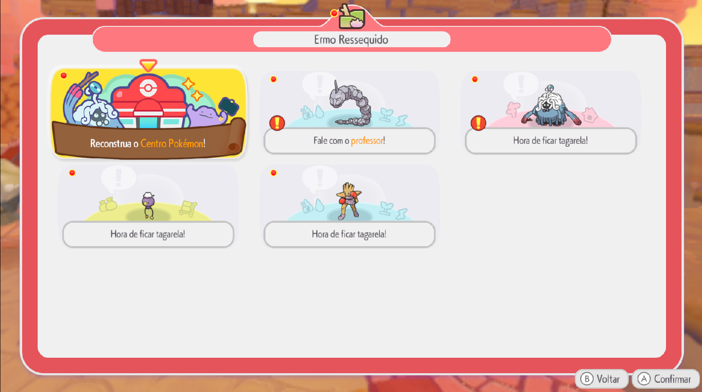
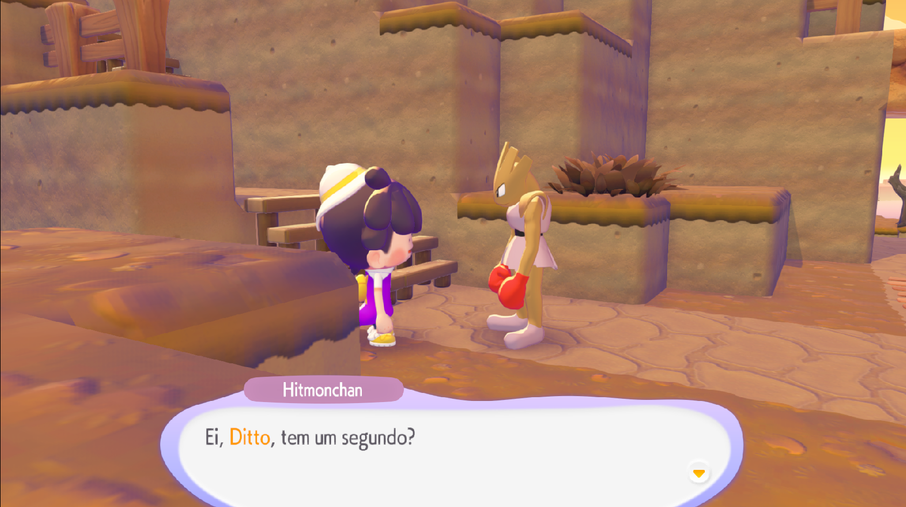
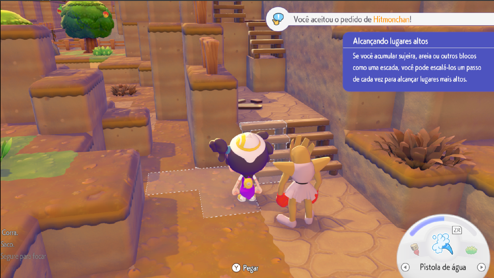
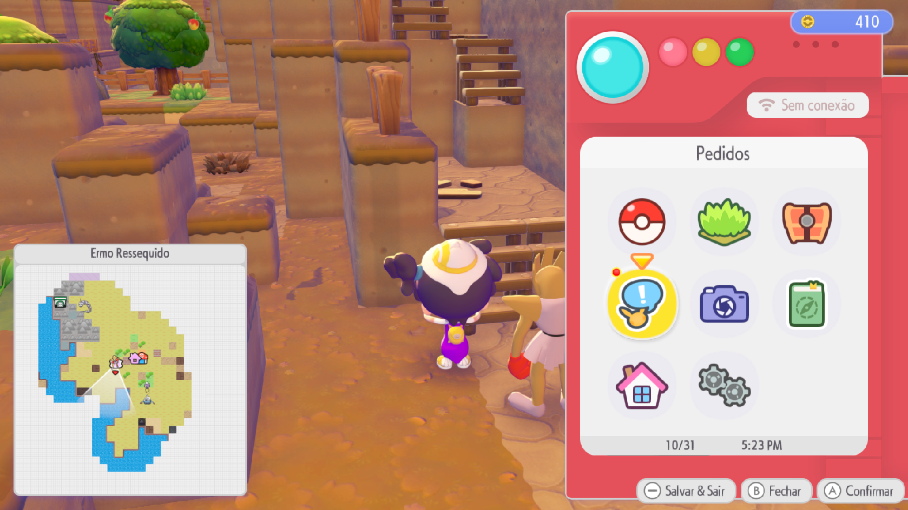

# Pokémon Pokopia — Tradução PT-BR

**Versão 0.0.5 — tradução parcial**

Patch comunitário para Pokémon Pokopia 1.0.4, aplicado ao RomFS do update 327680. O jogo deve permanecer configurado em inglês para carregar a tabela C0 modificada.

> ⭐ **Antes de baixar, dê uma estrela no repositório:** [LucianoNeo/pokemon-pokopia-pt-br](https://github.com/LucianoNeo/pokemon-pokopia-pt-br). Isso ajuda o projeto a chegar a mais jogadores.

## Sobre a tradução

A tradução é feita com auxílio de inteligência artificial e revisada manualmente. O projeto ainda está incompleto; alguns textos permanecem em inglês e novas correções virão em versões futuras.

## O que mudou na versão 0.0.5

- Adicionadas quatro capturas de tela para mostrar exemplos da tradução em uso.
- O ZIP traz os mesmos arquivos de texto da versão 0.0.4; esta atualização não altera o conteúdo traduzido do jogo. Ela mantém as revisões semânticas e contextuais anteriores.
- A tradução continua parcial; `PRESS A BUTTON` permanece em inglês.

## Exemplos no jogo

Capturas de tela da tradução em uso:

**Pedidos do Ermo Ressequido**

**Diálogo com Hitmonchan**

**Tutorial: alcançando lugares altos**

**Menu de pedidos**

## Arquivos do ZIP

- `romfs/LD_C0_R.BIN` — tabela de textos traduzidos.
- `romfs/LI_C0_R.IDX` — índice correspondente; deve ficar junto do arquivo de textos.

## Instalação

1. Feche o jogo. O emulador pode continuar aberto se o jogo não estiver rodando.
2. Faça backup dos arquivos correspondentes no update 327680.
3. Extraia o ZIP no mod RomFS do update 327680, preservando a árvore `romfs`. Na instalação manual, substitua os arquivos correspondentes dentro da pasta `romfs` do update.
4. Mantenha `LD_C0_R.BIN` e `LI_C0_R.IDX` juntos e deixe o idioma do jogo em inglês.

Para voltar aos arquivos originais, restaure os backups feitos antes da instalação.

## Aviso

Projeto comunitário não oficial. Pokémon e os arquivos originais do jogo pertencem aos respectivos detentores. O pacote contém apenas arquivos do patch; mantenha uma cópia legal do jogo e dos arquivos originais.
