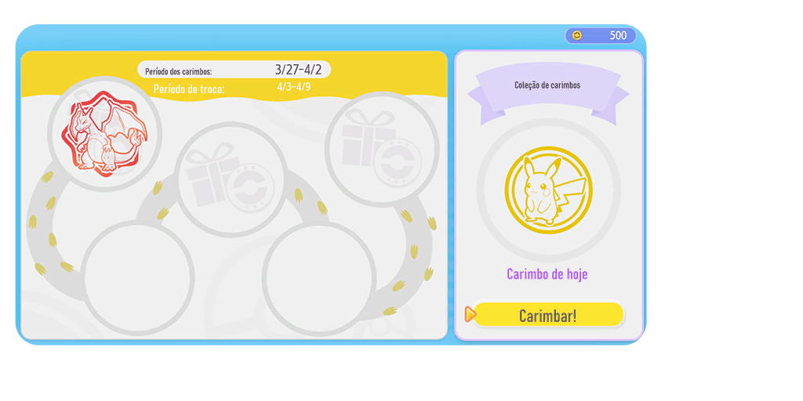
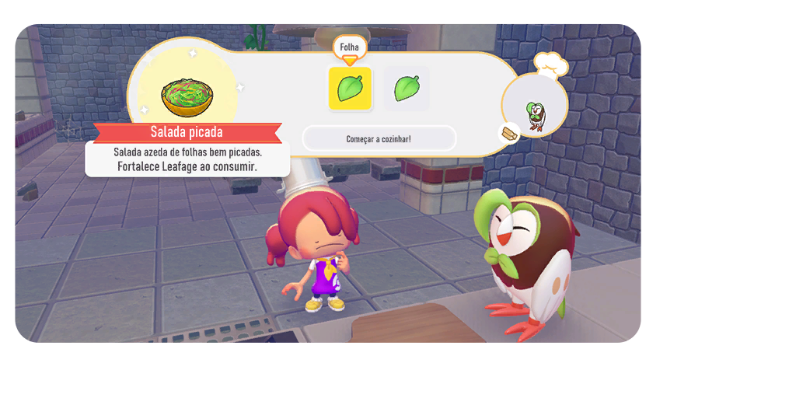
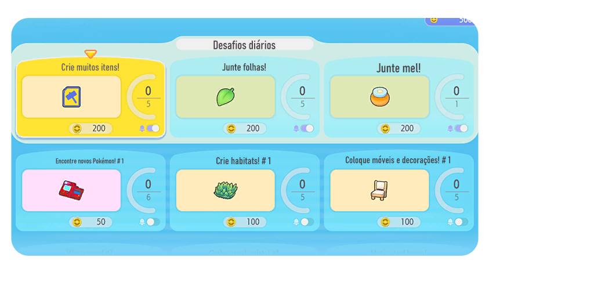
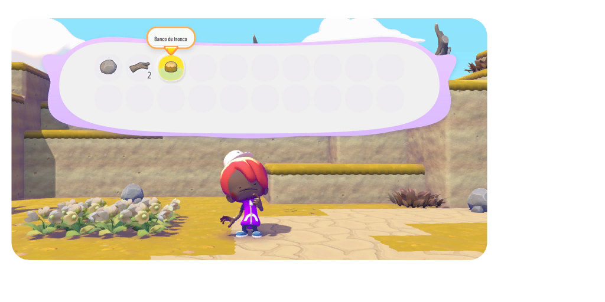

# Pokémon Pokopia — Tradução PT-BR

## Sobre o projeto

Tradução comunitária não oficial de **Pokémon Pokopia** para português brasileiro, por **LucianoNeo**, feita com auxílio de inteligência artificial e revisão manual. Esta versão é destinada ao jogo **2.0.1 e 2.0.1a**. Os nomes dos golpes permanecem em inglês por escolha do projeto.

**Versão do mod: 2.5.7**

| Versão do jogo | Update | Cobertura de localização |
| --- | --- | --- |
| **2.0.1 / 2.0.1a** | `655360` | **100% do conteúdo localizável catalogado** |

⭐ Antes de baixar, dê uma estrela no [repositório](https://github.com/LucianoNeo/pokemon-pokopia-pt-br) para apoiar o projeto.

## Download

[**Baixar a tradução PT-BR v2.5.7 — jogo 2.0.1/2.0.1a (ZIP com instalador)**](https://github.com/LucianoNeo/pokemon-pokopia-pt-br/releases/download/v2.5.7/Pokemon-Pokopia-PT-BR-v2.5.7.zip)

## Consultar e editar textos

O repositório inclui um editor local para visualizar, comparar com o RomFS original, pesquisar e alterar textos dos arquivos `LD_C0_R.BIN` / `LI_C0_R.IDX`, com backup automático ao salvar. Para iniciar no Windows, execute [`tools/text-editor/Iniciar_Editor.bat`](tools/text-editor/Iniciar_Editor.bat); consulte o [guia do editor](tools/text-editor/README.md).

## Conteúdo traduzido

| Versão do jogo | Entradas textuais traduzidas | Imagens/texturas traduzidas |
| --- | ---: | ---: |
| **2.0.1 / 2.0.1a** | **35.533** | **40** |

A cobertura de 100% se refere ao catálogo textual e às imagens identificados para localização no mod. A contagem textual inclui repetições e variantes; exclui campos apenas de pontuação e adaptações de unidades de medida. Nomes oficiais de Pokémon e de golpes permanecem como no jogo.

## Estrutura do pacote

O ZIP contém somente a pasta da versão compatível:

```text
README.md
Pokemon-Pokopia-PT-BR-Installer-v2.5.7.exe
2.0.1/
└── romfs/
    ├── LD_C0_R.BIN
    ├── LI_C0_R.IDX
    └── motor_asset_re/
        └── KIDS_PLATFORM_OUNCE/
            ├── root.rdb
            └── 0x4b13d561.fdata
```

## Imagens de exemplo









## Instalação

### Instalação automática

1. Extraia o ZIP para uma pasta.
2. Execute `Pokemon-Pokopia-PT-BR-Installer-v2.5.7.exe`.
3. Escolha uma pasta do jogo/update/`romfs` ou selecione um arquivo `.nsp`/`.nup`.
4. Feche o jogo antes de aplicar a tradução. O emulador pode continuar aberto se o jogo não estiver rodando. O instalador guarda os arquivos substituídos em `%LOCALAPPDATA%\PokemonPokopiaPTBR\backups`.

#### Usar um NSP no Eglantine

O instalador não modifica o NSP, pois os arquivos internos são criptografados. Ele instala os arquivos da tradução como mod LayeredFS no perfil do Eglantine. Selecione o NSP no instalador e, quando ele pedir uma pasta do emulador, localize a pasta `load` assim:

1. Abra a mesma cópia do Eglantine que você usa para iniciar Pokémon Pokopia.
2. No menu do emulador, clique em **File → Open Eglantine Folders → Mod Folder**. O Explorador abrirá a pasta `load` correta para esse perfil.
3. Volte ao instalador e selecione essa pasta `load`.
4. A tradução ficará em `load\0400A3A01EE4C000\romfs`. Inicie o jogo usando essa mesma cópia/perfil do Eglantine.

Se preferir localizar a pasta manualmente, clique com o botão direito no atalho do Eglantine, escolha **Abrir local do arquivo** e confira se existe uma pasta `user` ao lado de `eglantine.exe`:

- Se existir, o caminho do mod é `<pasta do Eglantine>\user\load\0400A3A01EE4C000\romfs`.
- Se não existir, o perfil costuma estar em `%APPDATA%\eden\load\0400A3A01EE4C000\romfs`. Pressione **Win + R**, digite `%APPDATA%\eden\load` e pressione Enter.

Se houver mais de uma instalação do Eglantine, abra **Mod Folder** no emulador usado para jogar. Cada cópia pode apontar para um perfil diferente.

Para um arquivo `.nup`, o instalador cria uma cópia traduzida e preserva o NUP original.

### Instalação manual

1. Feche o jogo. O emulador pode continuar aberto se o jogo não estiver rodando.
2. Faça backup dos arquivos correspondentes no RomFS do update **655360**.
3. Copie o conteúdo de `2.0.1/romfs` para a pasta `romfs` do update, substituindo os arquivos correspondentes. A pasta `2.0.1` organiza o ZIP e não deve ser copiada para dentro do RomFS.
4. Mantenha juntos os arquivos `LD_C0_R.BIN` e `LI_C0_R.IDX`, além dos dois arquivos em `motor_asset_re/KIDS_PLATFORM_OUNCE`.
5. Mantenha o idioma do jogo em **inglês** para carregar os textos traduzidos e inicie o jogo novamente.

Para desinstalar, remova o mod ou, se fez a substituição manual, restaure os backups originais.
